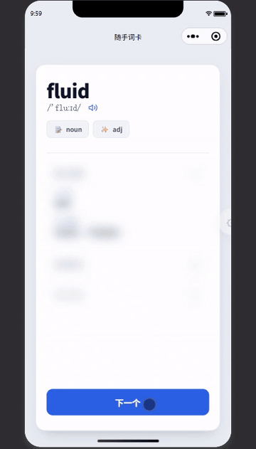
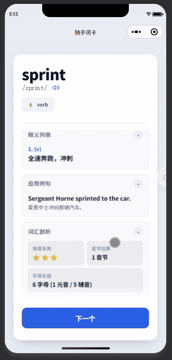

<div align="center">


# 随手词卡 · HandyCards

**⚡ 开源 · 零广告 · 免登录 · 纯离线 · 打开即用**
<br/>
<sub>一款回归记忆抽认卡（Flashcards）本质的极简背单词微信小程序</sub>

<p align="center">
  <a href="https://lanzm.github.io/HandyCards/"></a>
  <a href="https://mp.weixin.qq.com/"></a>
  <a href="LICENSE"></a>
  <a href="docs/BRAND.md"></a>
  <a href="#"></a>
  <a href="#-快速开始与自主部署"></a>
</p>

</div>

---

## ✨ 核心亮点

- ⚡ **开屏即用**：零商业广告插播、免登录注册、无社交打卡绑定，打开就是背单词。
- 📦 **真 · 纯离线**：全部词库本地打包内置，断网飞行模式、地铁通勤毫无阻碍。
- 🃏 **指尖翻卡流**：正面单词自测、轻触立体翻转揭晓释义，像刷短视频一样顺畅轻快。
- 🎯 **双刷词模式**：支持「自测遮挡模式」与「高效速览模式」随时一键无缝切换。
- 💡 **高频认知维度**：黄金短语搭配、形近词防混淆辨析、熟词生义考点陷阱、同根派生词族深度解析。
- 🌓 **暗黑模式与双语**：自动跟随系统深色主题，支持中英双语界面即时切换。
- 🍃 **微信分包架构**：主包体积仅 **520KB** 极速冷启动，分包静默预载，总离线容量扩展至 **20MB**。

---

## 📱 界面与操作演示

<div align="center">
  
  
  <br/>
  <sub><b>左：轻触立体翻卡揭晓释义与顺滑切词 &nbsp;&nbsp;|&nbsp;&nbsp; 右：全量离线词库切换与多模式设置</b></sub>
</div>

---

## 📖 内置离线词库

内置全部主流学习词库，采用微信小程序官方独立分包架构，默认四级词书位于主包即开即用，进阶词书位于分包静默预载：

| 词书名称 | 对应文件与分包位置 | 词汇量 | 架构与适用场景 |
| :--- | :--- | :---: | :--- |
| **四级核心词** | `src/static/CET4luan_1.json` | 1,162 词 | **主包内嵌** · 首屏秒开即学，四级必备 |
| **六级进阶词** | `src/subpackages/wordbooks/static/CET6luan_1.json` | 1,188 词 | **独立分包** · 后台静默预加载，六级拔高 |
| **考研英语** | `src/subpackages/wordbooks/static/KaoYanluan_1.json` | 1,328 词 | **独立分包** · 考研真题核心高频词汇 |
| **雅思词汇** | `src/subpackages/wordbooks/static/IELTSluan_2.json` | 3,056 词 | **独立分包** · 雅思学术类（A类）必备 |

---

## 🚀 快速开始与自主部署

只需一个个人微信小程序账号，即可发布属于你自己的专属私有背单词应用：

### 1. 克隆与安装

```bash
git clone https://github.com/lanzm/HandyCards.git
cd HandyCards
npm install   # 或 pnpm install
```

### 2. 本地开发与调试

```bash
npm run dev:mp-weixin
```
打开 **微信开发者工具** -> 点击「导入」 -> 选择项目目录下的 `dist/dev/mp-weixin` 即可实时预览与热重载。

### 3. 构建发布生产包

```bash
npm run build:mp-weixin
```
编译产物位于 `dist/build/mp-weixin`（主包仅 **520KB**，分包 **1.5MB**，微信开发者工具上传 0 报错）。在微信开发者工具中导入后，点击右上角 **「上传」** 提交微信审核即可。

### 4. 语音发音域名配置

若需使用在线真人语音发音，请在 [微信公众平台](https://mp.weixin.qq.com/) 的 **「开发管理 -> 开发设置 -> 服务器域名 -> request 合法域名」** 中添加：
```text
https://dict.youdao.com
```

---

## 🎨 品牌与视觉资产

随手词卡的官方 Logo、全套 1.18x 饱满矢量 SVG、纯白底微信头像及分享封面设计规范详见 **[🎨 docs/BRAND.md 品牌设计规范](docs/BRAND.md)**。

> ⚠️ **版权与独占声明**：「随手词卡」与「HandyCards」名称、官方 Logo、小程序码及全部视觉资产版权归原作者独家所有，严禁未经授权用于商业仿冒、换皮牟利或冒用官方名义。

---

## 🤝 开源与版权协议

本项目遵循 **[CC BY-NC 4.0（知识共享-署名-非商业性使用 4.0 国际许可）](LICENSE)** 协议开源：

- ✅ **个人免费学习研究**：允许个人学习研究、技术交流及个人部署自用；
- ❌ **严禁商业营利变现**：**严禁任何个人或机构将本项目代码打包转售、上架付费应用、或二次植入商业广告（包括但不限于小程序流量主各类广告）上线变现**；
- ❌ **严禁品牌仿冒**：未经书面授权，不得使用「随手词卡」或「HandyCards」的品牌名称与 Logo 进行二次分发，保留依法追究侵权下架之权利。

---

### ❤️ 支持与体验官方版

官方小程序永久秉持 **纯粹 · 零广告 · 免登录 · 纯离线**，欢迎微信扫码体验！

如果随手词卡在你的英语学习备考中有所帮助，欢迎在 GitHub 点个 **Star ⭐️** 支持作者，也欢迎推荐给身边正在备战四六级、考研、雅思的小伙伴！
